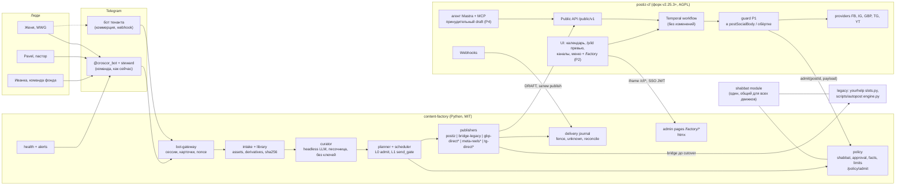

# Мастер-план: одна контент-платформа для служения, фондов и коммерции (2026-11-05)

Роль автора: ведущий архитектор. Это синтез, не новое исследование.
Входы лежат в этой папке. Обозначения ниже такие.
- [TF] `design-thin-fork-hybrid.md`, победитель всех трёх судей.
- [SC] `design-sidecar.md`, [DF] `design-deep-fork.md`, проигравшие дизайны, из них взяты прививки.
- [JD] `judge-delivery-risk.md`, [JX] `judge-cross-family.md`, [JC] `codex-judge-verdict.md`, вердикты.
- [PC] `postiz-code.md`, [PL] `postiz-live.md`, [YH] `yourhelp-system.md`, [WWG] `wwg-tenant.md`, [CF] `cf-core-fit.md`, [GA] `github-analogs.md`, отчёты скаутов.

Строки кода Postiz даны по тегу v2.25.3. Пометка "(не проверено)" стоит там, где факт взят из вывода или из чужого отчёта, а не из файла.
Живые системы при подготовке плана не трогал. Каждый шаг с пометкой **[прод]** требует отдельного апрува Pavel'я.

---

## 1. Цель и тенанты

### 1.1 Цель
Одна платформа ведёт контент для трёх видов организаций.
- `ministry`: служение, церковь, проповеди.
- `charity`: YourHelp, YourCamp, Our Kids, фонды.
- `commerce`: платные клиенты. Первый клиент WWG WOW Cleaning, Чикаго.

Люди работают с платформой двумя путями.
1. Telegram-бот. Человек шлёт фото, видео и слова. Бот отвечает, показывает план, просит апрув. Это тот же опыт, что у Иванки с @croscor_bot сегодня [YH §1].
2. Админка внутри Postiz. Календарь, превью и каналы остаются родными экранами Postiz. Экраны фабрики открываются из меню Postiz [TF §6].

Публикация идёт через Postiz. Временные прямые адаптеры живут только до доказанного Postiz-пути и имеют срок (раздел 8).
Платформу потом продаём. Поэтому второй тенант должен подниматься по README без личного окружения Pavel'я (`content-factory/MANIFEST.md:39`).

### 1.2 Тенанты на старте

| Тенант | kind | Апрув | Шабат-локации | Каналы | Сейчас публикует |
|---|---|---|---|---|---|
| `yourhelp` | charity | не нужен (слово Pavel'я 21.10 и 25.10, `yourhelp/autopost/intake/TASK-INTAKE.md:3-4`); донат-посты требуют апрува | Испания-конверт ∪ Киев | FB, IG, TG-канал "Your camp NEWS" | `yourhelp/autopost/slots.py`, 78 постов `posted` [YH §0] |
| `ourkids` | charity | required до слова Pavel'я (Q6) | Испания-конверт ∪ Киев | FB, IG (каналы есть в Postiz; `tokenExpiration` в прошлом, рабочесть токенов не проверена [PL п.3], [JC]) | никто |
| `ministry` (имя уточнить) | ministry | required до слова Pavel'я (Q6) | Испания-конверт ∪ Киев | уточнить | никто |
| `wwg` | commerce | обязателен, апрувер Женя | Чикаго ∪ Испания-конверт ∪ Киев | FB, IG, GBP | `server-root/scripts/autopost/engine.py`, крон `*/10` с 04.11 [WWG §0 п.1] |

YourCamp сегодня не отдельный тенант. Его TG-канал уже идёт в конвейере фонда [YH:32,55], [JC]. Сначала переносим его как канал тенанта `yourhelp`. Выделение в свой тенант делаем позже, отдельным шагом.

"Испания-конверт" объясняется в разделе 7.1. Город Pavel'я неизвестен, поэтому закат не угадываем.

---

## 2. Архитектура и отвергнутые варианты (готово для ADR)

### 2.1 Решение
**Тонкий форк Postiz + sidecar-фабрика.**
- `content-factory` (Python, MIT) владеет планом, апрувом по хешу, шабатом, фактами, журналом доставки, ботом и куратором. Проверенное ядро (185 тестов, `cf-core-fit.md` §0) остаётся.
- `postiz-cf` (публичный форк, AGPL-3.0) получает малый набор патчей. Каждый патч помечен `// FACTORY-PATCH`. Жёсткий потолок 10 точек касания upstream-файлов. Превышение потолка = сигнал пересмотреть решение (kill-criterion) [DF].
- Postiz хранит посты как `DRAFT`. DRAFT не запускает workflow (`posts.service.ts:964-966`) [JD п.3, проверено]. В слот фабрика проверяет политику и переводит пост в публикацию.
- Guard Postiz работает fail-closed и стоит перед каждой внешней мутацией, а не только в `postSocialBody`: первичная отправка, комментарии (`post.activity.ts:209-255`), финализация (`post.activity.ts:452-462`), plugs (`integration.service.ts:601-610`) и каждый HTTP внутри циклов провайдера (IG stories в `instagram.provider.ts:939-961`, медиагруппы TG). Так он ловит путь мимо фабрики: UI, Public API, MCP, агента. Подробно в 7.5 [critique-codex C01].

Почему: только этот вариант одновременно (а) даёт админку в Postiz, (б) делает шабат и апрув доказуемыми для всей системы, (в) не переписывает проверенное ядро. Баллы судей: 81 [JD], 78 [JX], 75 [JC]; все три условные, ни один дизайн не готов к проду как описан.

### 2.2 Отвергнутые варианты

| Вариант | Почему отвергли | Источник |
|---|---|---|
| (а) Свой движок без Postiz (запись `server-root/DECISIONS.md:18-22`, 04.11) | Pavel хочет работу через Postiz и админку в Postiz. Довод про advisories снимают v2.25.3 (закрыты 3 critical и 1 medium от 02.11 [PL:107]; прочие исторические advisories, на которых стояло решение 04.11, отдельно не проверены), forward_auth на UI и организация на тенанта | [PL], [TF §1] |
| (б) Sidecar без форка | Ручной `now` в UI Postiz обходит шабат и апрув. Дизайн сам это признаёт (`design-sidecar.md:186`). Sweeper только обнаруживает обход. Админка держится на HTML-инжекте через непрочитанный root-only `fanout_server.py` | [JD §3], [JX §1], [JC] |
| (в) Глубокий форк, всё внутри NestJS | Переписывает ядро и `slots.py` на TS, доказательства шабата обнуляются. 36-53 инженерных дня. Свои Temporal-workflow. Вечный rebase горячих файлов (`posts.service.ts` сменил 524 строки за минор) | [JD §3], [DF §13] |
| (г) План в БД Postiz, новая activity `admission` в workflow | Нужна новая версия workflow `post.workflow.v1.1.3.ts` и перенос при каждом изменении каталога (13 коммитов с мая) | [CF §2.1], [GA:92] |
| (д) Двусторонняя синхронизация плана | Две точки истины. Это класс багов "REPLACE vs append" | [CF §2.1] |
| (е) Нативный апрув Postiz | Его нет. Issue #1758 закрыт not_planned 03.11.2026 | [GA:96] |
| (ж) Диалоговый бот внутри Postiz | Telegram-провайдер Postiz только публикует, через `getUpdates` (`telegram.provider.ts:85-130`). Диалога нет | [PL п.5], [PC] |

### 2.3 Черновик записи в `content-factory/DECISIONS.md`
Ссылку на неё ставим в `server-root/DECISIONS.md`, запись от 04.11 помечаем "заменена".

> **2026-11-0x · Одна платформа: фабрика + тонкий форк Postiz.** Решение: content-factory = ядро для ministry, charity, commerce; Postiz-форк `postiz-cf` = админка и исполнитель; патчи помечены `FACTORY-PATCH`, потолок 10 точек касания; `scripts/autopost` и `yourhelp/autopost` выводятся по одному каналу после shadow. Служит цели MANIFEST "Postiz как исполнитель за адаптером Publisher" и "второй tenant по README". Отвергли: свой движок без Postiz (запись 04.11), sidecar без форка, глубокий форк, план в БД Postiz, двустороннюю синхронизацию. Условия, снимающие возражения 04.11: v2.25.3+, UI Postiz за forward_auth (кроме `/p/*`, OAuth-callback, `/public/v1` по IP), одна организация Postiz на тенанта, бэкап Postiz до первой публикации.

Правила в MANIFEST фабрики, которые меняются той же записью:
- "Postiz не модифицируем" (`ARCHITECTURE.md:83`) становится "модифицируем только патч-набором с потолком 10 точек".
- Non-goal "SPA-админка" (`MANIFEST.md:43`) остаётся. Экраны фабрики рендерит сама фабрика (FastAPI + htmx). Postiz только встраивает их.
- Инвариант "план владеет только фабрика" (`MANIFEST.md:12`) остаётся. DRAFT в Postiz = витрина, не план.

---

## 3. Схема компонентов



`*` = временный адаптер со сроком снятия (раздел 8).

Процессы и права ОС [TF §12].
- `factory-api` (policy, admin, webhook бота) и `factory-publisher` (ключи соцсетей) работают под разными пользователями.
- Куратор работает в песочнице без ключей и без сети к соцсетям.
- Токены ботов хранит только `bot-gateway`. Секреты лежат в vault (`inv-add`). В БД фабрики лежит только имя секрета.

---

## 4. Модель данных

База фабрики остаётся SQLite WAL с составными FK по tenant [CF §1]. `+` = новое поле или таблица.

```
Tenant        id, name, +kind {ministry|charity|commerce}, timezone, language,
              +shabbat_locations [{name, lat, lon, tz}]  -- минимум 1, иначе ошибка старта
              +approval_mode {none | required | required_for:[donation, offer, ...]}
              +facts_ref, +facts_version                  -- обязательны для commerce
              +postiz_org_id, +postiz_api_key_ref         -- имя секрета, не значение
              +limits {per_day, min_gap_min, per_channel}
Member        tenant_id, tg_user_id, +role {contributor|approver|admin|viewer},
              display_name, +language
+BotBinding   bot_id, token_ref, mode {steward|webhook}, tenant_ids[], secret_token_ref
Channel       tenant_id, kind {fb|ig|gbp|tg|yt|tiktok},
              +route {postiz|bridge_legacy|direct}, +route_until (дата снятия direct),
              postiz_integration_id | direct_ref,
              +active_publisher {factory|legacy_yourhelp|legacy_autopost}   -- ровно один
Asset         tenant_id, sha256, kind, source {bot|import|archive|history},
              from_member, captured_at, path, meta
Derivative    asset_id, profile {ig_4x5|reel_9x16_h264|gbp_1200|tg_doc|...},
              sha256, path, +postiz_media_path            -- неизменяемый
+FactClaim    tenant_id, fact_id, template, slots_schema, facts_version
Slot          tenant_id, id, when_utc, kind {post|carousel|reel|story|offer},
              text_by_channel, derivatives[], channels[], claims[],
              +content_hash, state, +origin {curator|manual|import},
              +postiz_post_ids {channel: id}, +send_deadline_utc
Approval      tenant_id, slot_id, content_hash, +actor_member_id,
              +via {tg|admin|grant|import}, +decision {approve|reject|edit_request},
              +comment, +nonce, ts
Delivery      tenant_id, slot_id, channel, UNIQUE(tenant, slot, channel),
              state {submitting|accepted|published|failed|unknown|deferred|missed|expired},
              external_ids, attempts, +source {factory|import_legacy}
+GuardEvent   ts, postiz_org_id, postiz_post_id, path {ui|api|mcp|agent|unknown},
              verdict {allow|deny}, reasons[], slot_id?
BotSession    bot_id, tg_user_id, tg_chat_id, member_id, +tenant_for_batch, +batch_expires_at,
              state (FSM), nonce_cards[]
+IngressUpdate bot_id, update_id UNIQUE(bot_id, update_id), tg_user_id, message_id,
              media_group_id, kind {media|text|voice|callback}, raw_ref, batch_id, ts
              -- пишется до ACK Telegram; повтор webhook не создаёт новый Asset/Slot
+Attempt      tenant_id, slot_id, channel, attempt_id, postiz_post_id, step {send|comment|finalize},
              state {reserved|sent|unknown|denied|done}, UNIQUE(postiz_post_id, step, attempt_id)
              -- одноразовая резервация guard; published/unknown повторно не выдаются
```

Правила модели.
1. **Хеш апрува v2** = sha256 канонического per-channel execution payload ПОСЛЕ всех преобразований Postiz: тексты по каналам после подстановки тегов и HTML-очистки, sha256 итоговых медиа после нормализации (PNG→JPEG, `posts.service.ts:522-583`), обложка и alt (`media.dto.ts:15-21`), id интеграций Postiz, settings провайдера, comments/thread, `inter` (repeat), формат, `when_utc` с точностью до минуты, digest файла фактов [DF:140], [JX §5], [critique-codex H08]. Нормализация медиа завершается до апрува. Динамические поля (releaseURL в тексте, `posts.service.ts:789-819`) для организаций фабрики запрещены. Любая правка любой части гасит апрув. Сейчас хеш включает весь конфиг канала вместе с settings, но без времени (`storage.py:160-169`).
2. **Актор обязателен и проверяется сервером.** `approve()` сейчас актора не пишет (`storage.py:186`) [CF]. Апрув commerce-тенанта принимается только от назначенного `approver` этого тенанта (по `tg_user_id` или пользователю Postiz из JWT), не от admin, куратора или импортированного гранта.
3. **Тенант = организация Postiz, 1:1.** `Customer` в Postiz границей доступа не служит [PC]. WWG получает свою организацию, а не Customer внутри "Your Help UA" [PL п.3].
4. **На канал ровно один активный публикатор.** Поле `active_publisher` меняется только шагом cutover. Это защита от дублей при миграции [JX §5].
5. **Импорт истории** до первой публикации фабрики, поканально и с namespace источника. `slots.py` ставит `posted`, если удался хотя бы один канал (`yourhelp/autopost/slots.py:226-230`), а `posted.jsonl` пишут и `slots.py`, и старый `autopost.py` (126 строк против 78 в state [YH:117-120]). Поэтому импорт раскладывает `result`/`errors` по каналам; канал без external_id получает `unknown`, а не `published`. Апрувы `approvals.json` импортируются как история (`via='import'`) и права на будущую отправку не дают [critique-codex H04].
6. **Шабат-локации пустыми быть не могут.** Сейчас по умолчанию пустой список (`config.py:59`, `tenants/demo/tenant.yaml:26`) [CF].

---

## 5. Разговор с ботом

Общие правила.
- Ключ сессии = (bot_id, tg_user_id). Один тенант у человека: выбор сам. Несколько: бот спрашивает кнопками. Выбор держится на пачку файлов, до 45 минут тишины, а не навсегда [SC:117].
- Карточку апрува получает только `approver`. `contributor` шлёт файлы и смотрит план.
- Язык ответа = `Member.language`. Иванке по-украински, Жене по-русски.
- Кнопки несут nonce и срок. Повторное нажатие ничего не делает [GA п.4].
- В окне шабата бот молчит. Входящие файлы кладутся в inbox. Ответ уходит после исхода субботы (решение в Q5).
- Команда фонда остаётся на @croscor_bot. Steward маршрутизирует `team-tool social send|plan|now|cancel|text` через `team_outbox.py:89-109` [YH §2.3]. Меняется только цель маршрута, по одному тенанту.
- **Кнопки в @croscor_bot сегодня не работают.** Единственный приёмник бота подписан только на `message` (`steward/croscor-bot/index.mjs:53`, `allowed_updates: ['message']` в `:119`), `callback_query` никто не принимает. Второй webhook на том же токене запрещён. Поэтому до карточек апрува нужна задача T2.6: relay `callback_query` в существующем приёмнике на Server 1, дедуп по `update_id`, проверка `from.id` на стороне политики, `answerCallbackQuery` [critique-codex H05].
- **Вход надёжный.** Каждый update пишется в `IngressUpdate` до ACK; альбом связывается по `media_group_id`, поздняя заметка и голосовое по окну пачки. Инструкции в заметках ("тільки сторіс", "тільки в канал", `yourhelp/autopost/intake/TASK-INTAKE.md:8-11`) входят в контракт пачки [critique-codex H14].

### 5.1 Женя одобряет пост WWG

```
Бот:  [медиагруппа, 7 превью 4:5]
Бот:  WWG · карусель · вт 10.11 10:00 Chicago
      Каналы: Facebook, Instagram, Google
      Текст IG: "Before and after: master bathroom, Chicago's North Shore. ..."  (publicLocation из файла фактов)
      Утверждения: "fully insured" (approvedClaims.fullyInsured; в хеше digest файла фактов)
      #a3f9c1 · ответ нужен до вт 10.11 10:00
      [Одобрить] [Поправить текст] [Другое время] [Не публиковать] [Превью]
Женя: (жмёт "Поправить текст")
Бот:  Напиши, что поменять.
Женя: убери локацию, клиент просил без неё
Бот:  Новая версия #b71e02. Старая карточка больше не действует.
      [медиагруппа] Текст IG: "Before and after: master bathroom. ..."
      [Одобрить] [Поправить текст] [Другое время] [Не публиковать] [Превью]
Женя: (жмёт "Одобрить")
Бот:  Одобрено. Выйдет вт 10.11 10:00 Chicago в FB, IG, Google.
...
Бот:  Вышло: FB, IG. Google: результат неизвестен, проверяю, повторно не шлю.
```

Поведение.
- "Одобрить" пишет `Approval(hash, actor=Женя, via=tg, nonce)`.
- "Поправить текст" отдаёт правку куратору. Новая версия получает новый хеш и новую карточку.
- "Превью" открывает `/p/[id]` Postiz. Превью DRAFT работает по коду (`getPostsRecursively` не фильтрует state) (не проверено на живом инстансе) [GA:101].
- Срок карточки = время слота. Одно напоминание за 3 часа до слота, вне шабата. Нет ответа к сроку: `expired`, Жене одна строка "не вышло, нет ок" [SC:139-142].
- Число отзывов в тексты не ставим, пока Женя не выберет цифру. Файл фактов разрешает "100+", сайт отдаёт 200, GBP 45 [WWG §0 п.5].

### 5.2 Иванка шлёт фото из лагеря

```
Иванка: [12 фото]
Бот:    Прийнято 12 файлів. Чекаю ще, зберу пост після тиші 45 хв.
Иванка: це вечірнє служіння, третій день табору
Бот:    Записала підпис.
        (45 минут тишины, куратор собирает)
Бот:    Готово. Попереду 3:
        • сьогодні 18:30 · карусель 8 фото · FB, IG, канал табору
        • завтра 12:00 · сторіс 3 фото · IG
        • завтра 18:30 · рілс 40 с · FB, IG, канал табору
        Змінити: "текст 1 ...", "скасувати 2", "зараз 1".
Иванка: скасувати 2
Бот:    Скасовано: завтра 12:00 сторіс.
```

Это формат сегодняшних ответов фонда [YH "на что опираются"]. Апрув не нужен, правка через команды. Донат-пост получит карточку апрува Pavel'ю.

### 5.3 Пастор шлёт видео проповеди

```
Пастор: [видео 48 мин, 2.1 GB]  (ссылка на файл; через hosted Bot API бот скачивает только до 20 MB)
Бот:    Принял "проповедь 08.11". Обработка займёт <время по замеру на S2>.
        Музыку хвалы из нарезки уберу: CCLI не покрывает соцсети.
        (транскрипция, выбор фрагментов куратором)
Бот:    Нашёл 4 фрагмента для рилсов:
        1. 0:12:40-0:13:35 "Благодать не заработать" [превью]
        2. 0:21:05-0:21:58 ...
        3. ...   4. ...
        План: пн, ср, пт до 12:00, вс. Субботы нет.
        [Взять все] [Выбрать] [Поправить подписи] [Отмена]
Пастор: Выбрать 1, 3
Бот:    Ставлю 2 рилса: пн 09.11 и ср 11.11, 18:00. Субтитры вшиты.
```

Транспорт больших файлов: hosted `getFile` ограничен 20 MB (https://core.telegram.org/bots/api#file), steward качает именно так (`steward/inbox.py:208-229`). Для проповеди нужен local Bot API server (лимит 2000 MB) или загрузка по ссылке с проверкой SSRF и размера; время обработки обещаем только после замера на S2 (T3.6) [critique-codex M03].
Основание: правило хвалы и CCLI из ConnectClips и sermon-shorts [GA п.5]. Транскрипция идёт по глобальной цепочке (Groq, затем Cloudflare Workers AI, Azure никогда). Пятничный слот получает `send_deadline` (раздел 7.1).
Лица и имена детей крупно только с пометкой согласия. Это предложение, Pavel его не подтверждал.

---

## 6. Админка в Postiz

### 6.1 Как встроена (патч P2)
1. Одна строка в `components/layout/top.menu.tsx:10-216` с `role: ADMIN` [TF §6].
2. Новая страница `apps/frontend/src/app/(app)/(site)/factory/[[...path]]/page.tsx`. Она рендерит iframe на `/cf/...` того же домена. Caddy проксирует `/cf/*` на фабрику, origin общий.
3. SSO. Новый маленький контроллер форка `GET /factory/token` берёт текущего пользователя и организацию и подписывает JWT на 60 секунд (HS256, общий секрет; `sub`, `org`, `aud`, `iss`, `exp`, `jti` для одноразового обмена). Фабрика проверяет JWT, сопоставляет пользователя Postiz с `Member` тенанта и выдаёт свою сессию; роль (`approver`, `admin`) берётся из `Member`, а не из роли Postiz. Права проверяются сервером фабрики на каждом чувствительном действии. Контроллер обязан иметь `@CheckPolicies`: эндпоинт без него `PoliciesGuard` пропускает (`permissions.guard.ts:39-41`), а `role` в меню только фильтр отображения (`top.menu.tsx:250-253`). Platform-superadmin отделён от SUPERADMIN организации [critique-codex H12]. Фабрика не читает БД Postiz и не знает паролей.
4. Мост до сборки форка: на тестовом стенде достаточно прямого входа `/cf/*` за forward_auth. HTML-инжект через `fanout_server.py` не используем: его код никто не читал [PL п.6].

### 6.2 Экраны

| Экран | Для кого | Что внутри |
|---|---|---|
| `/factory/inbox` | admin | что пришло в боты, от кого, статус разбора, пачки |
| `/factory/library` | admin | исходники, теги, derivatives, "использовано в слотах", история прошлых постов |
| `/factory/plan` | admin, approver | слоты по дням: статус апрува, хеш, ссылка на превью, причина отказа admit |
| `/factory/approvals` | approver | карточки как в TG, история решений с актором, diff хешей |
| `/factory/policy` | admin | окна шабата на 8 недель по каждой локации, лимиты, файл фактов и его версия, шаблоны утверждений |
| `/factory/journal` | admin | delivery, `unknown`, GuardEvent, кнопка "сверить" (только чтение) |
| `/factory/bots` | superadmin | привязка ботов к тенантам, режим, проверка webhook. Так "бот реализован в Postiz" видно в админке [графт судьи 1] |
| `/factory/tenants` | superadmin | тенанты, участники, роли, связь с организацией Postiz |
| `/factory/health` | admin | живость фабрики, последний tick, guard-отказы за 24 ч, очередь `unknown` |

Календарь, превью `/p/[id]` и подключение каналов остаются родными экранами Postiz.
**Посты фабрики в родном редакторе только для чтения.** Postiz меняет дату (`posts.service.ts:1409`), settings (`:1234`) и через MCP `post.settings.tool.ts:74-80` только у себя, в Slot это не попадает. Патч P2b блокирует эти мутации для постов с меткой фабрики и ведёт в `/factory/plan`; правка там даёт новую версию и новую карточку. Второго плана нет [critique-codex H13].
Вид: htmx, стиль подогнан под Tailwind-тему Postiz. Визуальную часть делаем через `hallmark` по глобальному правилу.

---

## 7. Политика: шабат, апрув, лимиты, и где она стоит

### 7.1 Шабат
- **Один модуль** `content_factory/shabbat.py` поверх `solar.py:7-26` и `planner.py:17-41`. Его импортируют фабрика, `yourhelp/autopost` и `server-root/scripts/autopost` уже в фазе F1 [SC §6.1], [JD §4]. Сегодня три движка считают по-разному. ADS: пятница с 09:30 Чикаго (`publish.py:96-108`). autopost: 10:28 Чикаго 06.11. YourHelp: фиксированно 15:00-21:00 Киева (`autopost.py:289-296`), летом раньше исхода субботы [WWG §0 п.4], [YH].
- **Окно** = объединение окон всех локаций тенанта. Окно одной локации: закат её локальной пятницы минус 30 минут, закат её субботы плюс 70 минут (40 цеит и 30 запаса). Пятница считается по часовому поясу каждой локации, а не по одной tz тенанта, как сейчас (`planner.py:20-34`). Неизвестный закат = запрет (`planner.py:35-37`).
- **Цена Киева в объединении для WWG.** По `solar.py` на 06.11.2026 окно Киева начинается в 13:57Z = 07:57 Chicago (CST), Жироны в 16:08Z = 10:08 Chicago, Чикаго в 22:10Z. С Киевом у WWG зимой нет пятничных слотов после ~07:00 Chicago. По глобальному правилу Pavel'я сейчас действует Испания вместо Киева; включать ли Киев в union, решает Pavel (Q7). До ответа держим строгий вариант.
- **Испания-конверт.** Город Pavel'я неизвестен. Берём несколько точек по краям материковой Испании (например, A Coruña, Girona, Cádiz, Almería), окно = от самого раннего начала до самого позднего конца. Канары конверт не покрывают: Тенерифе даёт конец окна 07.11 19:28Z против 18:34Z у Кадиса (расчёт `solar.py`). Набор точек утверждает Pavel или он называет город (Q2). Экстремумы на 52 недели проверяет T1.1 векторами.
- **send_deadline** = начало окна минус lead. Lead 15 минут для фото, 60 минут для видео [SC:172]. Работает в L0 и L1. Остаточный риск записываем честно: удалённая загрузка, принятая провайдером до дедлайна, может завершиться позже. Это в DEBT [JC].
- **Минимумы зашиты в код.** Конфиг тенанта может расширить окно, но не сузить.
- **В окне молчит всё.** Нет публикаций, карточек, напоминаний, сводок, запусков куратора, обработки медиа. Бот только складывает входящие. Запущенные до окна jobs (куратор, ffmpeg, retry-таймеры) останавливаются на границе, а не только не стартуют. Алерты guard в окне копятся и уходят после исхода.
- **Инвентарь всей автоматики со стоп-контрактом (T1.10).** Кроме фабрики и guard: дайджест-письма Postiz (`digest.email.workflow.ts:33-63`), обработка медиа (`media.activity.ts:10-19`), сообщения при подключении TG-канала (`telegram.provider.ts:112-130`), инструменты агента (`chat/tools/tool.list.ts:24-46`), сводки YourHelp после куратора (`yourhelp/autopost/intake/run.sh:51-64`, проверка окна только в `:22`), CI и бэкапы [critique-codex H10].
- **Ошибка = запрет.** Сегодня `run.sh:22` трактует любой ненулевой код (ошибка импорта, закрытый vault) как "не шабат". Общий модуль ставится в каждый рантайм пакетом с версией; ошибка импорта или расчёта даёт явный deny с отличимым кодом. Тест: закрытый том, нет пакета, плохая tz [critique-codex H11].
- **Общие JSON-векторы** `tests/vectors/shabbat.json`: 52 недели × все локации, граница ±1 минута. Их гоняет CI каждого движка [DF §5].

### 7.2 Апрув
- `approval_mode` тенанта. WWG = required. Фонд = none, кроме донат-постов.
- Апрув действует только для хеша v2 (раздел 4). Правка в редакторе Postiz после апрува меняет хеш, guard это ловит.
- Для commerce-тенанта грант (`via=grant`) на будущие посты невозможен: апрув даёт только назначенный approver тенанта (раздел 4, правило 2). Сегодняшний грант карусели WWG остаётся историей legacy-движка и прецедентом не служит. Для charity грант допустим как явное исключение с записью в журнал.
- YourHelp без апрува опирается на прямое слово Pavel'я (`yourhelp/autopost/intake/TASK-INTAKE.md:3-5`). На Our Kids и служение это слово не распространяется: до ответа на Q6 у них `required` [critique-codex C04, принято частично].

### 7.3 Факты (commerce)
- Текст строится из `FactClaim`: шаблон утверждения плюс подстановка из `approved-business-facts.json`. В хеш входит digest файла фактов, а не вручную присвоенный номер [JX §4 п.2], [JC]. Правка файла фактов гасит все ожидающие апрувы.
- Любое утверждение о компании (качество, средства, гарантии, цены, отзывы, локация) берётся только из закрытого набора типизированных шаблонов с путём к значению в файле фактов. Свободная проза куратора фактов не добавляет: "we use eco-safe products" без шаблона отклоняется, $175 допустим только в паре со `standard` (`approvedStartingPricesUsd`, `prohibitedPublicClaims` в файле фактов) [critique-codex H09].
- Валидатор отклоняет число или гарантию вне шаблонов. Запрещённые фразы ("200+ reviews") в чёрном списке [WWG п.5]. Текст на картинке проверяем OCR derivative перед апрувом. Для видео: OCR ключевых кадров, транскрипт речи и проверка `visualRules` (неретушированные пары before/after, только утверждённые файлы лиц). Сомнительное сырьё уходит в карантин на ручной разбор (T3.7).
- Апрув владельца не отменяет проверку фактов.

### 7.4 Лимиты
`per_day`, `min_gap_min`, `per_channel` по реальному времени, DST-безопасно (`planner.py:59-64`). Донат-посты фонда: лимит и апрув в коде, а не только в промпте [YH].

### 7.5 Где политика стоит, чтобы Postiz не мог её обойти

| Слой | Где | Что ловит | При отказе |
|---|---|---|---|
| L0 admit | `planner.admit()` при создании и пересчёте слота | шабат, send_deadline, лимиты, факты, capability канала | слот не ставится, куратор получает причину |
| L1 send_gate | `scheduler.py:113-124` перед каждым HTTP фабрики | шабат на момент отправки, апрув по текущему хешу, ручная отмена | `deferred` на тот же fence |
| L2 guard P1 | форк Postiz, перед каждым вызовом провайдера | всё, что пришло мимо фабрики: UI, Public API, MCP, агент, повторы, финализация | `BadBody`, пост в `ERROR`, `GuardEvent`, алерт |
| L3 sweeper | фабрика, раз в минуту читает посты организаций | диагностика: пост в QUEUE без слота, рассинхрон статусов | алерт, откат в DRAFT через `PUT .../status` |
| L4 сверка | фабрика после каждого перевода статуса и по Webhooks | молча проглоченные ошибки `terminate` (`posts.service.ts:961-963,1403`) | `unknown` + алерт |

Контракт L2 (правки судей) [JX §3-4], [JC].
1. **Точка guard.** Не `postSocialInternal`: upstream пометил его на удаление после дренажа V108 (`post.activity.ts:336-339`). Одного `postSocialBody` мало: комментарии (`post.activity.ts:209-255`), финализация (`:452-462`) и plugs (`integration.service.ts:601-610`) зовут провайдер мимо него. Guard стоит в общей обёртке перед КАЖДЫМ внешним HTTP/SDK-send, включая шаги внутри одного вызова провайдера: цикл `media_publish` IG stories (`instagram.provider.ts:939-961`), медиагруппы TG, `/feed` FB после параллельной загрузки фото (`facebook.provider.ts:865-925`). Окно шабата может начаться между двумя шагами одной activity. Smoke после rebase проверяет, что запрет срабатывает, а не что патч наложился [critique-codex C01].
2. **Инвентаризация путей.** До кода P1 перечисляем все пути, где Postiz вызывает провайдер: публикация, двухфазная финализация, повторы, комментарии, репосты, plugs, repeat [PC:43-61]. Поиск идёт по `apps` и `libraries` (провайдеры и HTTP-клиент лежат в `libraries`). Каждый путь получает guard или явное обоснование, почему вызова соцсети нет. Для организаций фабрики comments, plugs, repeat (`intervalInDays`, `post.workflow.v1.1.2.ts:623-633,706-725`, запускает дочерний workflow с `postNow: true` в обход проверки QUEUE `:161-173`) запрещены на сервере до отдельного допуска.
2a. **Повторы мутаций.** `social.abstract.ts` повторяет тот же запрос после 429, 500 и provider-retry без различения GET/POST и без нового вызова политики (`social.abstract.ts:628-653`); GBP создаёт localPost этим клиентом (`gmb.provider.ts:475-487`). Патч P1b: мутирующий запрос после 500, обрыва или неизвестной ошибки не повторяется без доказанного отсутствия эффекта, каждый повтор проходит политику заново. Workflow v1.1.2 держит ручной цикл до 5 итераций вокруг mutation с `maximumAttempts: 1` (`post.workflow.v1.1.2.ts:113,433-445`) и считает отсутствие heartbeat доказательством "не стартовала" (`:271-276`), хотя первый heartbeat идёт только через 15 с (`temporal.heartbeat.ts:45-76`). Эти ветки тоже под патч и под тест [critique-codex C02].
2b. **ERROR ≠ отказ.** `markUnconfirmed()` пишет `ERROR` (`post.workflow.v1.1.2.ts:312-327`), а `publishers/postiz.py:88-89` переводит ERROR в FAILED, тест это закрепляет (`tests/test_postiz.py:55-60`). Фабрика различает policy-denied-before-send, provider-rejected, partial и unconfirmed; ERROR без deny-записи guard = `unknown`. Известные release ID сохраняются и при ERROR (`post.activity.ts:305-324`).
3. **Неизвестный пост = отказ.** Пост без связи со слотом фабрики получает deny. Исключений для "ручных" постов нет.
3a. **Одноразовая резервация.** `/policy/admit` не просто сверяет хеш, а атомарно резервирует `Attempt(postiz_post_id, step, attempt_id)`. Пост с Delivery в `published` или `unknown` повторно не допускается. Причина: `changePostStatus` (`posts.service.ts:1384-1406`, Public API `PUT /posts/:id/status`) ставит QUEUE и запускает workflow без `guardAgainstRepublish` (`:1157-1165`), то есть уже опубликованный и одобренный пост можно запустить снова с тем же хешем [critique-codex C03].
4. **Хеш по реальным байтам.** Guard передаёт в `/policy/admit` организацию, интеграцию, текст, пути медиа, settings, publishDate и номер попытки. Фабрика пересчитывает хеш v2 и сравнивает с апрувом. Медиа фабрика загружает в Postiz сама и хранит `postiz_media_path` + sha256. Перезаписываемость файла в хранилище Postiz не проверена. Если путь перезаписываем, guard хеширует файл сам.
5. **Аутентификация.** Вызов guard подписан секретом организации. Ответ кешируется не дольше одной попытки.
6. **Fail-closed.** Фабрика недоступна = deny. Пост в `ERROR` от guard на первом шаге не имеет публичного эффекта, поэтому фабрика после восстановления создаёт новую попытку на тот же fence, но только если журнал `Attempt` доказывает, что ни один внешний шаг этой попытки не начался. Отказ на втором и следующих шагах (частичный успех) = `unknown`, без автоповтора. Обязательно: health-алерт (фабрика молчит больше 2 минут, guard-отказ при недоступной политике) и runbook "фабрика лежит" в `content-factory/docs/runbook-guard.md` [графт судьи 1].
7. **Агент и MCP.** P4 принудительно ставит `draft` в `integration.schedule.post.ts:115-116` для всех организаций фабрики. Агент остаётся полезным, но опубликовать сам не может [DF], [JD п.6].
8. **Права.** P3 убирает выдачу всех способностей при пустом `STRIPE_PUBLISHABLE_KEY` (`permissions.service.ts:49-61`) [JD п.7]. Deny-тест обязателен до аккаунта Postiz не-Pavel'ю.

**Релизный шлюз** на каждом апгрейде upstream, на стенде с подменой часов [JX §6], [JC].
- Пост в окне шабата не уходит ни через UI, ни через Public API, ни через MCP, ни через агента.
- Неодобренный нативный пост отклонён. Пост чужого тенанта отклонён.
- Правка после апрува снимает апрув.
- Фабрика недоступна = публикации нет.
- Финализация через границу шабата безопасна.
- Потерянный ответ провайдера даёт `unknown` без слепого повтора, включая 500 от GBP и ретраи `social.abstract.ts`.
- `PUT /posts/:id/status` со `schedule` для опубликованного поста отклонён; два конкурентных workflow на один пост дают один внешний объект.
- Падение воркера после быстрого успеха и до первого heartbeat даёт `unknown`, не повтор.
- Окно шабата, начавшееся между двумя шагами одной activity (IG stories, TG-альбом), останавливает следующий шаг.
- Правка даты, settings или удаление DRAFT фабрики в родном UI и через MCP отклонены.
Зелёная сборка и наложенный патч успехом не считаются.

---

## 8. Матрица каналов

| Канал / формат | Маршрут сейчас | Цель | Основание | Срок снятия direct |
|---|---|---|---|---|
| IG карусель до 10, фото + видео | Postiz | Postiz | `instagram.provider.ts:60,986` [PC] | нет direct |
| IG Reels, Stories | Postiz | Postiz | `instagram.provider.ts:760-772` | нет direct |
| FB мультифото ("карусель") | Postiz | Postiz | `facebook.provider.ts:864-911`, сетка `attached_media`. Листаемой фото-карусели у органических постов страницы, по памяти, нет (не проверено) | нет direct |
| FB одно видео | Postiz | Postiz | `facebook.provider.ts:835-862` | нет direct |
| FB Reels | meta-direct фабрики (`meta.py:73,109`) | Postiz после P5 (`/video_reels`), PR в upstream | в Postiz `/video_reels` нет [CF] | P5 обязателен до первого рилса через платформу |
| FB/IG Stories | Postiz | Postiz | `facebook.dto.ts:102-104` | нет direct |
| GBP пост: 1 фото + CTA | legacy `scripts/autopost/gbp.py` до cutover | Postiz `gmb` | `gmb.provider.ts:439-447` берёт первый файл; env GBP в Postiz нет [PL п.4]; OAuth-клиент = `GOOGLE_GMB_CLIENT_ID || YOUTUBE_CLIENT_ID` (`gmb.provider.ts:22-27`), противоречия нет | **обязательная фаза F6**, проверка доступа к API в T0.4 до разработки |
| GBP видео | не делаем | не поддерживается | `checkValidity` отклоняет видео (`gmb.provider.ts:59-74`), ветка VIDEO в теле поста поддержки не даёт | не рекламируем |
| TG-канал (табор) | `yourhelp/slots.py` | Postiz telegram с отдельным ботом-паблишером после патча P7 | Postiz подключает через `getUpdates` (`telegram.provider.ts:85-130`), с webhook @croscor_bot несовместимо. Провайдер кладёт весь текст в caption (`telegram.provider.ts:239`, лимит Telegram 1024 символа), не передаёт размеры видео и сохраняет только `response[0].message_id` первой группы (`:287`). `slots.py:115-130` отделяет длинный текст и хранит все message_id | tg-direct фабрики как мост, снять после P7 + F6 [critique-codex H06] |
| YouTube Shorts | Postiz | Postiz | ключи YT в env есть [PL п.3] | нет direct |
| TikTok | нет | позже | аккаунт WWG не найден [WWG] | |

Правила для всех каналов.
- Частичный успех не блокирует остальные каналы. Публичную частичную отправку автоматически не повторяем (`MANIFEST.md:23`).
- GBP сегодня под риском. Публикатор ADS стоит с 03.11 на "unknown GBP POST outcome" (93 падения), тот же OAuth и аккаунт у WWG [WWG §0 п.3]. `unknown` не повторяем, сверка только чтением.
- Видео перед отправкой проходит ffprobe: H.264, yuv420p, SAR 1:1, faststart, размеры и длительность (глобальное правило).

---

## 9. Миграция YourHelp и YourCamp: сначала shadow

Принцип strangler. Старый конвейер публикует, пока новый не докажет паритет. Переключаем по одному каналу. На канал всегда один активный публикатор.

| Шаг | Что | Primary signal |
|---|---|---|
| M1 импорт | `slots-state.json` и `posted.jsonl` (78 записей) в `Delivery` как `published`, `source=import_legacy` | счёт и external_ids совпадают 1:1 |
| M2 shadow intake | `team_outbox.py` отдаёт пачку в оба движка: старый inbox и `factory intake` [DF:234] | 14 дней: каждая пачка есть в обоих |
| M3 shadow plan | фабрика строит свой план из того же сырья и пишет "что бы опубликовала" | инварианты: каждая пачка покрыта, ни один слот не в окне шабата, лимиты соблюдены, редакторская сверка Pavel'ем. Побайтовый ноль расхождений двух LLM-планов не требуем |
| M4 bridge | фабрика становится владельцем плана, `bridge-legacy` пишет её план в `slots.json`, публикует по-прежнему `slots.py`. В том же шаге отключаются или переадресуются все прочие писатели плана: intake-builder (`intake/run.sh:39-49`), архивный добор (`run.sh:69-91`), `social.py` text/cancel (`intake/social.py:110-125`), `push-slots.sh`, забор лички (`run.sh:24-35`); переносятся pending, contributors, last_in_ts, archive-used [critique-codex H03] | 7 дней без дублей и пропусков, Иванка видит те же ответы, архивный добор и украинская сводка работают |
| M5 TG-канал | `active_publisher=factory` для канала табора. Legacy этот флаг не читает (`slots.py:198-201` и `AP/engine.py:344-368` блокируют слот целиком), поэтому T8.1 правит оба legacy-потребителя: экспорт моста содержит только их каналы, переключение идёт через generation/lease с drain начатых слотов, описан обратный cutover [critique-codex H01] | 7 дней без дублей; тест с работающим tick старого движка во время переключения |
| M6 FB, затем IG | то же по одному каналу | по 7 дней каждый |
| M7 выключение | `yourhelp/autopost` только чтение, кроны сняты [прод] | 14 дней тишины старых кронов |

Почему такой порядок. Судьи указали, что в [TF] бот переключался раньше моста старых каналов [JX §5], [JC]. Здесь intake переходит только после того, как план фабрики питает старый публикатор.

По дороге закрываем.
- Дубль при падении между публикацией и записью состояния (`slots.py:226-230`). Закрывает fence журнала до HTTP.
- Шабат 15:00-21:00 Киева заменяется общим модулем уже в F1.
- Сбой ночного забора из лички (`Node.js v20.20.2` в `run.log`) пишем в DEBT. Оставлять ли забор из лички, решает Pavel позже.

Our Kids и служение входят сразу в фабрику, без legacy. Сначала проверяем живость page-токенов Our Kids чтением Graph API [прод-чтение].

---

## 10. WWG: первый запуск

1. **Сегодняшняя карусель.** `WWG-first-bathroom` стоит на 05.11 11:00 Chicago (fb, ig, gbp, 7 файлов) в `scripts/autopost/engine.py` [WWG §0 п.2]. Просьбу Pavel'я "карусель тоже публикуй" выполняет этот движок. Повторно её не публикуем ни руками, ни через фабрику: будет дубль. Я ничего не запускал.
2. Если GBP-часть даст `unknown`, как у ADS: сверка только чтением, без повторного POST. Разбирает человек.
3. Грант `grant by Pavel` в `approvals.json` противоречит правилу "Женя одобряет каждый пост". Pavel подтверждает его задним числом как разовое исключение (Q3).
4. **Рилс `WWG-1106-sink`, пт 06.11 10:00 Chicago.** Запас до окна autopost 28 минут. По `send_deadline` 60 минут он запрещён. По `solar.py` окно Жироны начинается в 10:08 Chicago, окно Киева уже в 07:57 Chicago (06.11, CST), так что в объединении платформы слот 10:00 запрещён и без lead. Рекомендация: перенести на понедельник 09.11 (Q3).
5. **Неделя из iCloud-библиотеки** (фазы F2-F3, до форка).
   - Импорт 607 файлов из `/secure/automation/wwg-content/icloud-20261104/originals/manifest.json` как `source=import` с sha256, без копирования исходников (311 фото, 296 видео, 19.09 GB) [WWG].
   - Импорт 41 Reels IG и 44 видео FB как `history`, чтобы куратор не повторялся.
   - Derivatives на S2: HEIC в JPEG, 4:5 1080×1350 для каруселей, рилсы H.264 1080×1920 до 90 с.
   - Куратор собирает неделю: 3-4 слота, только утверждения из `FactClaim`.
   - Женя одобряет карточками в @croscor_bot (у него `social: ["wwg"]` уже есть).
   - Одобренные слоты уходят через `bridge-legacy` в план `scripts/autopost`. Публикует пока autopost. Один публикатор на канал.
   - **Ограничение моста.** Legacy-отпечаток WWG берёт пути файлов, а не байты (`AP/engine.py:63,141-147`), и проверяет шабат и апрув один раз перед слотом, не перед каждым HTTP (`:352-368`). Поэтому мост копирует одобренные derivatives в неизменяемые пути (по sha256) и передаёт хеш фабрики; autopost перед каждым каналом зовёт общий send_gate. Пока этого нет, мост = переходный режим со старыми гарантиями, и "доказанный шабат и апрув" до cutover на Postiz не обещаем [critique-codex H02].
6. **Cutover WWG на Postiz** (F7). Условия: форк на проде, бэкап Postiz, WWG-организация и каналы подключены, GBP через Postiz прошёл тест, 7 дней shadow без расхождений. Затем `active_publisher=factory` по одному каналу. Первый пост фабрики = следующий одобренный Женей.

Срок до первого поста WWG через Postiz: оценка [JX §7] 14-15 инженерных дней плюс 7 дней shadow не учитывает задачи, добавленные ревью (T1.9, T2.6, T4.9-T4.12). Честная оценка после доказательного среза (раздел 11, F-proof). Польза для Жени через мост приходит раньше, но не раньше T2.6 (кнопки в @croscor_bot); 6-8 инженерных дней не подтверждены декомпозицией.

---

## 11. Фазы и задачи для параллельных агентов

Исполнители по глобальному правилу.
- `codex` = механика: boilerplate, импорты, конвертации, страницы, скрипты сборки.
- `sonnet` (xhigh) = логика с правами, состоянием, политикой; порт с паритетом; ревью диффа Codex.
- `opus` = архитектура, контракты, финальная проверка primary signal.
Работа идёт в рабочих копиях и worktree. Никаких прод-действий без апрува. Задачи с одинаковой фазой и без общих файлов идут параллельно.

Пути: `CF` = `~/www/content-factory`, `PZ` = `~/www/postiz-cf` (новый форк), `AP` = `~/www/server-root/scripts/autopost`, `YH` = `~/www/yourhelp/autopost`, `ST` = `~/www/server-root/scripts/steward`.

### F0. Решения и подготовка (0.5 д + ожидание Pavel'я)

| ID | Роль | Файлы | Готово когда | Проверка |
|---|---|---|---|---|
| T0.1 | opus | `CF/DECISIONS.md`, `server-root/DECISIONS.md`, `CF/MANIFEST.md` | запись 2.3 стоит в обоих логах, MANIFEST обновлён | `grep -n "Одна платформа" CF/DECISIONS.md ~/www/server-root/DECISIONS.md` |
| T0.2 | Pavel + opus [прод] | `/opt/postiz/*`, БД фабрики | согласованный бэкап всего графа состояния: `pg_dump` + uploads Postiz, Temporal, SQLite фабрики (WAL-consistent snapshot), mapping медиа; runbook восстановления с карантином отправок до сверки неоднозначных попыток [critique-codex M05] | после восстановления на стенде не повторился ни один существующий соцобъект и сохранился неопубликованный одобренный слот; `SELECT count(*)` только вторичный сигнал |
| T0.3 | Pavel [прод] | Caddy `croscor-infra.caddy:34` | таблица реальных внешних путей и доступа (browser, social fetcher, S2 API): UI за forward_auth; открыты `/p/*` и его статика, `/api/public/posts/*` для превью (`public.controller.ts:54-87`), OAuth-callback, `/api/public/v1` по IP (в комплектном nginx Public API идёт под `/api/`, `var/docker/nginx.conf:20`; живой путь проверить), `/uploads/*` только для derivatives, `/cf/tg/*` [critique-codex M01] | внешний браузер: `/launches` 401/302, `/p/<id>` открывается; Meta/GBP реально скачивают медиа тестового поста на стенде |
| T0.4 | Pavel + sonnet | GCP-проект, Business Profile API | доступ к Business Profile API и OAuth-клиент для `gmb` проверены ДО разработки F4 | тестовый `GET` локаций GBP чтением |

### F1. Ядро политики (3-4 д, всё параллельно, кроме T1.7)

| ID | Роль | Файлы | Готово когда | Проверка |
|---|---|---|---|---|
| T1.1 | sonnet | `CF/src/content_factory/shabbat.py`, `CF/tests/vectors/shabbat.json`, `CF/tests/test_shabbat_vectors.py` | union локаций, минимумы в коде, send_deadline, Испания-конверт; 52 недели × Чикаго, Киев, 4 точки Испании | `cd CF && .venv/bin/python -m pytest -q tests/test_shabbat_vectors.py` |
| T1.2 | sonnet | `CF/src/content_factory/config.py`, `models.py`, новая миграция `migrations/003_platform.sql` | `kind`, `shabbat_locations` обязателен, `approval_mode`, `limits`, `Member.role`, `BotBinding`, `active_publisher` | `pytest -q tests/test_config.py`; старт с пустыми локациями падает |
| T1.3 | sonnet | `CF/src/content_factory/storage.py` | хеш v2, актор и via в Approval, nonce | `pytest -q tests/test_storage.py -k approval` |
| T1.4 | sonnet | `CF/src/content_factory/facts.py`, `tenants/wwg/claims.yaml` | шаблоны утверждений, версия фактов, отказ на неизвестное число и гарантию | `pytest -q tests/test_facts.py`; "200+ reviews" отклонён |
| T1.5 | sonnet | `CF/src/content_factory/api/policy.py` (FastAPI) | `/policy/admit` с подписью, пересчёт хеша, deny для неизвестного поста | `pytest -q tests/test_policy_api.py` |
| T1.6 | codex | `CF/src/content_factory/importers/{yourhelp,autopost}.py` | импорт 78 записей фонда и журнала WWG, апрувы как `via=grant` | `factory import --dry-run` печатает 78 и счёт WWG, совпадает с `jq length` |
| T1.7 | sonnet | `AP/engine.py`, `YH/slots.py`, `YH/autopost.py`, `YH/intake/run.sh` (локальная копия) | оба legacy-движка зовут общий `shabbat` как установленный пакет с версией у root и pavel, не через `sys.path` на checkout в vault; ошибка = deny с отличимым кодом; `run.sh:22` перестаёт трактовать ошибку как "не шабат"; деплой отдельно [прод] | векторы в каждом репо + тесты: закрытый том, нет пакета, плохая tz дают deny; diff ревьюит opus |
| T1.8 | opus | весь F1 | ревью инвариантов, 185+ тестов зелёные (вторичный сигнал) | `cd CF && .venv/bin/python -m pytest -q` |
| T1.9 | sonnet | `CF/src/content_factory/publishers/postiz.py`, `tests/test_postiz.py` | протокол draft-upsert → mapping (durable до старта workflow) → promote → reconcile. Сейчас адаптер сразу шлёт `type: now` (`postiz.py:57`), а `type: now` перезаписывает дату (`posts.service.ts:1190-1192`), тогда как `PUT status` дату не меняет; выбран один путь promote. ERROR без deny guard = `unknown`. Добавлен `gmb` в `PROVIDERS` [critique-codex H07, C02] | тесты: promote не меняет хеш, неизвестный guard'у пост не создаётся, ERROR → unknown |
| T1.10 | opus + sonnet | `CF/docs/automation-inventory.md`, `CF/src/content_factory/shabbat.py` | инвентарь всей автоматики (раздел 7.1) с владельцем и стоп-контрактом, включая уже запущенные jobs и алерты | каждый пункт инвентаря имеет тест или ручную проверку с подменой часов |

### F2. Бот и апрув (3-4 д, на немодифицированном Postiz)

| ID | Роль | Файлы | Готово когда | Проверка |
|---|---|---|---|---|
| T2.1 | sonnet | `CF/src/content_factory/bot/gateway.py`, `bot/sessions.py` | webhook `/cf/tg/{bot_id}` с secret_token, сессии, выбор тенанта на пачку, молчание в шабат | `pytest -q tests/test_bot_gateway.py` с подменой часов |
| T2.2 | sonnet | `CF/src/content_factory/bot/cards.py` | карточки с nonce, срок = слот, одно напоминание за 3 ч, `expired`, правка через куратора | тестовый чат: approve, edit, reject, expiry; повторное нажатие не срабатывает |
| T2.3 | sonnet | `ST/team_outbox.py`, `ST/team.json` (локально) | маршрут `social` тенанта в `factory intake` по флагу, формат ответов Иванки дословно | shadow: одна пачка видна в старом inbox и в фабрике |
| T2.4 | codex | `CF/src/content_factory/bot/i18n/{uk,ru,en}.yaml` | тексты бота трёх языков, украинский по образцу `yourhelp/intake/social.py` | `pytest -q tests/test_bot_i18n.py` |
| T2.5 | codex | `CF/src/content_factory/publishers/bridge_legacy.py` | экспорт одобренных слотов в план autopost и `slots.json`; только каналы, чей `active_publisher` = legacy; derivatives в неизменяемых путях по sha256 | dry-run diff против текущего `slots.json` пустой на тех же слотах |
| T2.6 | sonnet | `ST/croscor-bot/index.mjs` (Server 1, локальная копия), `ST/team_outbox.py` | relay `callback_query` в существующем приёмнике: `allowed_updates` + обработчик, durable пересылка, дедуп `update_id`, проверка `from.id` на стороне политики, `answerCallbackQuery`; общий интерфейс отправки клавиатур; деплой отдельно [прод] | тестовый чат: нажатие доходит до фабрики один раз, повторная доставка webhook не даёт второго апрува |
| T2.7 | sonnet | `CF/src/content_factory/bot/ingress.py` | `IngressUpdate` до ACK, связь альбома, поздней заметки и голосового с пачкой, восстановление после рестарта | тест: альбом + поздняя заметка + голосовое + смена тенанта во время загрузки; повтор webhook не создаёт Asset |

### F3. Библиотека и куратор (4 д, параллельно с F2)

| ID | Роль | Файлы | Готово когда | Проверка |
|---|---|---|---|---|
| T3.1 | codex | `CF/src/content_factory/library/import_manifest.py` | 607 файлов как Asset с sha256 без копирования | `factory library stats --tenant wwg` = 311 фото, 296 видео |
| T3.2 | codex | `CF/src/content_factory/library/derivatives.py` | HEIC→JPEG, 4:5, 9:16 H.264 faststart, ffprobe-проверка; считается на S2 фоном, пауза в шабат | `ffprobe` каждого derivative: h264, yuv420p, SAR 1:1 |
| T3.3 | opus | `CF/tenants/*/curator.md`, `CF/src/content_factory/curator/contract.json` | промпты по kind, строгий JSON, валидация через `admit()` | 3 прогона на сырье WWG: 0 утверждений вне `FactClaim` |
| T3.4 | codex | `CF/src/content_factory/library/history.py` | импорт прошлых постов FB/IG WWG как `history` | куратор не предлагает уже опубликованные кадры |
| T3.5 | sonnet | `CF/src/content_factory/media/sermon.py` | транскрипция по цепочке, выбор фрагментов, пропуск музыки хвалы, нарезка с вшитыми субтитрами | один тестовый файл даёт 3-5 смонтированных рилсов с субтитрами, прошедших ffprobe и video-critique |
| T3.6 | sonnet | `CF/src/content_factory/bot/large_files.py` | файлы больше 20 MB: local Bot API server или загрузка по ссылке с проверкой SSRF и размера; замер обработки 48-минутного файла на S2 | реальный 2 GB файл принят, время обработки записано |
| T3.7 | sonnet | `CF/src/content_factory/media/qa.py` | OCR ключевых кадров видео, транскрипт речи, `visualRules`, карантин сомнительного сырья | ролик с неутверждённым утверждением в кадре или в речи отклонён |
| T3.8 | sonnet | `CF/src/content_factory/curator/runner.py` | раннер куратора: очередь, lease, восстановление, стоп на границе шабата | убитый на середине прогон восстанавливается без дубля слотов |

### F4. Форк Postiz (5-6 д, параллельно с F2-F3)

| ID | Роль | Файлы | Готово когда | Проверка |
|---|---|---|---|---|
| T4.1 | opus (sonnet помогает) | `PZ/FACTORY-PATCHES.md` | инвентаризация всех внешних мутаций до уровня HTTP/SDK-send, включая циклы внутри провайдеров; точка guard выбрана с учётом удаления `postSocialInternal` | каждый путь из `rg -n "getSocialIntegration|this\.fetch\(|\.(post|comment|finalizePost)\(" PZ/apps PZ/libraries` отмечен |
| T4.2 | sonnet | `PZ/apps/orchestrator/src/activities/post.activity.ts`, новый `factory-policy.client.ts` | P1 guard, fail-closed, подпись, хеш по байтам | стенд: подмена часов, deny по UI, API, MCP, агенту |
| T4.3 | sonnet | `permissions.service.ts:49-61` | P3, deny без Stripe | deny-тест второго пользователя на стенде |
| T4.4 | codex | `integration.schedule.post.ts:115-116` | P4, принудительный `draft` для организаций фабрики | агент на стенде создаёт только DRAFT |
| T4.5 | codex | `top.menu.tsx`, `(site)/factory/[[...path]]/page.tsx`, контроллер `/factory/token` | P2 меню, iframe, JWT 60 с | Pavel открывает `/factory/plan` из меню Postiz на телефоне и десктопе |
| T4.6 | sonnet | `PZ/scripts/rebase.sh`, `PZ/scripts/behavior-matrix.sh` | rebase на тег, сборка `postiz-cf:<tag>-cfN`, релизный шлюз из 7.5 | `bash PZ/scripts/behavior-matrix.sh` = все пункты PASS |
| T4.7 | codex | `PZ/deploy/compose.test.yml` | отдельный тестовый инстанс на S2: свой project, порты, БД | `docker compose -p postiz-cf-test ps` здоров; живёт до конца F6, потом поднимается на каждый апгрейд upstream ради релизного шлюза |
| T4.8 | codex | CI `PZ/.github/workflows/weekly-rebase.yml` | еженедельный пробный rebase на upstream main | отчёт о конфликтах раз в неделю (не в субботу) |
| T4.9 | sonnet | `social.abstract.ts`, `post.workflow.v1.1.x.ts`, `factory-attempt.client.ts` | P1b: мутации не повторяются после 500/обрыва без политики; ручной цикл и heartbeat-эвристика не дают второй отправки; журнал `Attempt` | стенд: 500 от провайдера, обрыв, падение воркера до heartbeat дают `unknown` и один внешний объект |
| T4.10 | sonnet | `posts.service.ts` (`changePostStatus`, `changeDate`, `updatePostSettings`), `post.settings.tool.ts` | P2b: посты фабрики read-only в родном UI и MCP; `changePostStatus` уважает `guardAgainstRepublish` | правка даты/settings/удаление DRAFT фабрики отклонены; `PUT status=schedule` опубликованного поста отклонён |
| T4.11 | sonnet | `telegram.provider.ts` (P7), PR в upstream | длинный текст отдельным сообщением, размеры и обложка видео, все message_id | длинный украинский текст + 10 фото, смешанный альбом, видео; сбой после первой группы сохраняет все ID |
| T4.12 | codex | конфиг форка | для организаций фабрики выключены comments, plugs, repeat, дайджест-письма и уведомления в окне шабата | стенд с подменой часов: ни одного письма и ни одной мутации в окне |
| T4.13 | codex | `PZ/README.md`, подвал UI, `PZ/scripts/build.sh` | AGPL с первого сетевого использования форка: ссылка на Corresponding Source для пользователей UI/API, точный commit = digest образа, скрипты сборки и установки, notices изменённых файлов (`PZ/LICENSE:122-133,196-221,542-548`). Polotno: проверенное выключение на этапе сборки или лицензия, он импортируется во frontend (`polonto.tsx:12-18`) [critique-codex M04] | по ссылке из UI собирается тот же образ |

### F5. Админка (3 д, после T1.5 и T4.5)

| ID | Роль | Файлы | Готово когда | Проверка |
|---|---|---|---|---|
| T5.1 | sonnet | `CF/src/content_factory/admin/auth.py` | приём JWT, сессия по `postiz_org_id`, чужой тенант не виден | `pytest -q tests/test_admin_auth.py` |
| T5.2 | codex | `CF/src/content_factory/admin/pages/*.html` | 9 экранов из 6.2, htmx, тема Postiz, дизайн через `hallmark` | скриншоты 1700 и 390 px; Никита проверяет после выката |
| T5.3 | sonnet | `CF/src/content_factory/health.py`, `CF/docs/runbook-guard.md` | health-алерт в TG Pavel'ю, runbook "фабрика лежит" | остановка фабрики на стенде даёт алерт за 2 мин |

### F6. Каналы через Postiz (3-5 д + ожидание Google/Meta)

| ID | Роль | Файлы | Готово когда | Проверка |
|---|---|---|---|---|
| T6.1 | Pavel + sonnet [прод] | env Postiz, OAuth | GBP через провайдер `gmb`, проверен доступ GCP-проекта к Business Profile API | тестовый пост на тестовой локации, external_id в журнале |
| T6.2 | sonnet | `facebook.provider.ts` (P5) | `/video_reels` для `post_type: reel`, PR в upstream | тестовая страница: рилс опубликован, id сверен |
| T6.3 | sonnet | `CF/src/content_factory/webhooks.py` | Postiz Webhooks переводят Delivery в `published`; сверка остаётся запасной | потеря webhook на стенде даёт `unknown`, не повтор |
| T6.4 | codex | Postiz telegram с ботом-паблишером | TG-канал через Postiz | тестовый канал, message_id в журнале |

### F7. WWG cutover (2 д + 7 д shadow)

| ID | Роль | Готово когда | Проверка |
|---|---|---|---|
| T7.1 | Pavel [прод] | образ `postiz-cf` на проде после бэкапа, T4.13 (source offer) и `call-guard`-подобной проверки нагрузки S2 | `/health` Postiz, behavior-matrix на проде в режиме только чтения |
| T7.2 | sonnet | WWG-организация, каналы, `active_publisher=factory` по одному каналу | 7 дней shadow: 0 расхождений; первый пост одобрил Женя, вышел с external_ids |
| T7.3 | opus | крон `AP` для WWG снят [прод] | 14 дней тишины старого крона |

### F8. YourHelp M1-M7 (5-7 д кода + 6-8 недель наблюдения), раздел 9.
T8.1 (sonnet): оба legacy-потребителя (`YH/slots.py`, `AP/engine.py`) уважают поканальное владение, generation/lease, drain и обратный cutover. T8.2 (sonnet): перевод всех писателей плана YourHelp в шаге M4. T8.3 (codex): поканальный импорт истории с namespace (раздел 4, правило 5).

### F9. Коммерческая упаковка (5 д)
P6 бренд, свой бот на тенанта, свой шаблон превью без бренда Postiz, Dedicated-шаблон compose, README "второй тенант на чистой установке", проверка лицензии Polotno (до проверки редактор выключен в коммерческой сборке). Отдельный commerce-инстанс поднимаем при первом внешнем платящем клиенте или раньше по Q4.

Сумма фаз исходного плана была 31.5-36.5 инженерных дня, а не 30-34. С задачами, добавленными ревью (T0.4, T1.9, T1.10, T2.6, T2.7, T3.6-T3.8, T4.9-T4.13, расширенный F8), грубо 45-55 инженерных дней; оценка не подтверждена декомпозицией. Наблюдение идёт параллельно.

**F-proof, доказательный срез (первым после F0).** Один одобренный Женей слот WWG в FB, IG, GBP через Postiz на стенде, guard на всех шагах, карточка через T2.6, весь негативный набор релизного шлюза. После среза пересчитываем patch surface (потолок 10 точек) и сроки. Критический путь: F0 + T0.4 → F1 → F-proof → F2 → мост WWG → F4 + F6 → F7.

---

## 12. Риски

| Риск | Вероятность | Последствие | Мера |
|---|---|---|---|
| Upstream удаляет `postSocialInternal` и меняет activity | высокая | guard тихо пропадает | guard в теле или своей обёртке; поведенческий шлюз после каждого rebase |
| Неучтённый путь вызова провайдера | средняя | публикация в шабат или без апрува | T4.1 инвентаризация, deny для неизвестного поста, sweeper L3 |
| Фабрика лежит, guard блокирует всё | средняя | тихий простой публикаций | health-алерт, runbook, повтор той же попытки после восстановления |
| Ошибки `terminate` глотаются (`posts.service.ts:961-963,1403`) | средняя | спящий workflow жив | L4 сверка после каждого перевода, `unknown` + алерт |
| GBP API не одобрен или повторяет случай ADS | высокая | GBP выпадает у WWG | bridge на legacy до T6.1, `unknown` без повтора |
| Потолок 10 точек касания пробит | средняя | вечный rebase | kill-criterion: пересмотр решения; провайдерные патчи сразу в upstream PR |
| Дубль при миграции | средняя | два одинаковых поста | `active_publisher` один на канал, импорт истории до первой публикации |
| Куратор придумывает факт | средняя | ложная реклама WWG | шаблоны утверждений, OCR текста на картинке, апрув Жени |
| Испания-конверт режет слоты | высокая | меньше пятничных постов | ожидаемо; объясняем в сводке |
| Токены всех клиентов в одном Postiz | средняя | утечка у коммерции | отдельный commerce-инстанс (Q4), секреты в `.env` 600 |
| Бэкапа Postiz нет | факт сегодня | потеря каналов и постов | T0.2 до любой публикации через Postiz |
| AGPL и iframe-граница | низкая, неясная | требование открыть фабрику | форк публичный, ссылка "Source" в подвале; фабрика MIT; юридически не проверено |
| Нагрузка на S2 (прод alivespace, форж) | средняя | давление на память, ~0.8 GB на стек [PL] | тестовый инстанс поднимаем на время F4-F6 и апгрейдов; рестарты только с проверкой нагрузки |
| Ретраи POST внутри Postiz (`social.abstract.ts:628-653`) | высокая | дубль поста после 500 | P1b (T4.9), ERROR = unknown |
| Повторный запуск опубликованного поста через `PUT status` | средняя | дубль одобренного поста | одноразовая резервация `Attempt`, T4.10 |
| Правка в родном UI Postiz расходится с планом | высокая | тихий отказ guard, потерянная правка | read-only для постов фабрики (P2b) |
| Ошибка импорта шабат-модуля = разрешение | средняя | публикация в шабат legacy | пакет с версией, ошибка = deny (T1.7) |
| Кнопки не доходят из @croscor_bot | факт сегодня | апрув Жени невозможен | T2.6 до моста WWG |
| Киев в union WWG | факт расчёта | нет пятничных слотов WWG после ~07:00 Chicago зимой | Q7 |

---

## 13. Вопросы к Pavel'ю

1. **Решение.** Принимаешь тонкий форк Postiz + фабрику и отмену записи `server-root/DECISIONS.md` от 04.11? Форк будет публичным под AGPL, фабрика отдельно под MIT.
2. **Шабат.** Назовёшь город в Испании? Без него ставим Испания-конверт по краям страны ∪ Киев.
3. **WWG на этой неделе.** Переносим рилс `WWG-1106-sink` с пт 06.11 10:00 Chicago на пн 09.11? Грант на сегодняшнюю карусель считаем разовым исключением?
4. **Инстанс.** Один Postiz на всех или отдельный commerce-инстанс уже для WWG?
5. **Бот в шабат.** Полностью молчит до исхода субботы или отвечает одной автострокой? Автострока тоже считается отправкой.
6. **Апрув у Our Kids и служения.** Твоё слово "без апрува" было про YourHelp. Распространяем его на Our Kids и служение? До ответа там required.
7. **Киев в шабат-окне WWG.** С Киевом в объединении у WWG зимой пропадают все пятничные посты после ~07:00 Chicago. Оставляем Киев или берём только Испанию (по твоему правилу на время поездки) + Чикаго?

---

## 14. Changelog: ревью Codex (2026-11-05)

Источник: `critique-codex.md` (Codex, reasoning high, статическое чтение клона Postiz `v2.25.3`, HEAD `a5affe62`). Каждую находку перепроверил по коду сам; ниже вердикт и что поменялось.

| Находка | Вердикт | Своя проверка | Что изменено в плане |
|---|---|---|---|
| C01 guard только в `postSocialBody` | подтверждено | `postComment` зовёт `getIntegration.comment` мимо `postSocialBody` (`post.activity.ts:209-255`); `finalizePost` `:452-462`; plugs `integration.service.ts:601-610`; цикл `media_publish` в IG `instagram.provider.ts:939-961` | 2.1, 7.5 п.1-2, T4.1 (поиск и по `libraries`), релизный шлюз |
| C02 ретраи POST и ERROR→FAILED | подтверждено | `social.abstract.ts:628-653` повторяет при 429/500; `postiz.py:88-89` ERROR→FAILED; `markUnconfirmed` пишет ERROR (`post.workflow.v1.1.2.ts:312-314`) | 7.5 п.2a, 2b, 6; T1.9, T4.9; риск |
| C03 повтор опубликованного поста | подтверждено | `changePostStatus` (`posts.service.ts:1384-1406`) без `guardAgainstRepublish` (`:1157-1165`); repeat `intervalInDays` с `postNow: true` (`post.workflow.v1.1.2.ts:624-715`) | модель `Attempt`, 7.5 п.3a, repeat запрещён, T4.10, шлюз |
| C04 исключения из owner approval | частично | Жёсткое правило задачи про WWG (Женя одобряет каждый пост). YourHelp без апрува = прямое слово Pavel'я (`TASK-INTAKE.md:3-4`), это не нарушение. Подтверждено: грант Pavel'я для будущих постов WWG и апрув без проверки актора | 1.2 (Our Kids, служение → required до Q6), 4 п.2, 7.2, Q6 |
| H01 `active_publisher` legacy не читает | подтверждено | `slots.py:198-201`, `engine.py:344-368` блокируют слот целиком | M5, T2.5, T8.1 |
| H02 мост со слабыми гарантиями | подтверждено | отпечаток по путям `engine.py:63,141-147`; проверка один раз перед слотом | 10 п.5 "Ограничение моста" |
| H03 несколько писателей плана | подтверждено | `run.sh:39-49`, архивный добор `run.sh:69-91` | M4, T8.2 |
| H04 импорт "78 published" | подтверждено | `slots.py:226-230`: `posted`, если удался хоть один канал | 4 п.5, T8.3 |
| H05 кнопки не доходят | подтверждено | `croscor-bot/index.mjs:53` только `message`, `:119` `allowed_updates: ['message']` | раздел 5, T2.6, риск, срок моста |
| H06 TG-провайдер Postiz | подтверждено | весь текст в caption (`telegram.provider.ts:239`), сохраняется `response[0].message_id` (`:287`) | матрица каналов, T4.11 |
| H07 нет DRAFT→promote адаптера | подтверждено | `postiz.py:57` шлёт `type: now`; `type: now` перезаписывает дату (`posts.service.ts:1190-1192`) | T1.9 |
| H08 хеш не по итоговому payload | подтверждено (по цитатам Codex, выборочно) | нормализация медиа и releaseURL в `posts.service.ts` | 4 п.1 |
| H09 пример с отсутствующим фактом | подтверждено | в `approved-business-facts.json` нет `family_owned` и Naperville | 5.1 пример переписан на `fullyInsured` и `publicLocation`; 7.3 закрытые шаблоны, видео-QA, T3.7 |
| H10 шабат не покрывает всю автоматику | подтверждено | `digest.email.workflow.ts`, `media.activity.ts:10-19`, сводки `run.sh:51-64` после проверки окна в `:22` | 7.1, T1.10, T4.12 |
| H11 ошибка импорта = разрешение | подтверждено | `run.sh:22`: `if ...; then exit 0` → любой ненулевой код значит "не шабат" | 7.1 "Ошибка = запрет", T1.7 |
| H12 SSO без RBAC | подтверждено | `permissions.guard.ts:39-41` пропускает без `@CheckPolicies`; `top.menu.tsx:250-253` только фильтр | 6.1 п.3 |
| H13 родной редактор против плана | подтверждено | `changeDate` `posts.service.ts:1409`, MCP `post.settings.tool.ts:74-80` | 6.2 read-only, T4.10, шлюз |
| H14 вход без durable-контракта | подтверждено | модель знала только `tg_chat_id`, нет `update_id`/`media_group_id` | модель `IngressUpdate`, раздел 5, T2.7 |
| M01 пути forward_auth | подтверждено для комплектного nginx | `nginx.conf:20` `location /api/`; превью `public.controller.ts:34,54-87`. Живой Caddy-путь не проверял | T0.3 |
| M02 расчёт окон | подтверждено | свой прогон `solar.py` 06.11: Киев 13:57Z (07:57 CST), Жирона 16:08Z (10:08 CST), Тенерифе конец 19:28Z | 7.1, 10 п.4, Q7 |
| M03 2 GB через бота | подтверждено | `inbox.py:212` hosted `api.telegram.org/file`, лимит 20 MB | 5.3, T3.6 |
| M04 AGPL только декларативно | подтверждено (чтение лицензии, не юр. заключение) | `PZ/LICENSE` §13 | T4.13, T7.1 |
| M05 бэкап только Postiz | подтверждено | fence в SQLite фабрики (`002_recovery.sql`) | T0.2 |
| M06 сроки | подтверждено | сумма фаз 31.5-36.5, а не 30-34 | раздел 11 итог, F-proof, T0.4, T4.7, F8 |
| L01 неточности | подтверждено 4 из 5 | хеш уже включает settings (`storage.py:165-168`); 3 critical + 1 medium (`postiz-live.md:107`); баллы 81/78/75; OAuth GBP `gmb.provider.ts:22-27`, видео GBP отклонено `:59-74`. Опровергнуто: `tenants/demo/tenant.yaml` действительно содержит `blackout: []`, Codex смотрел `examples/` | 2.1, 2.2, 4 п.1, матрица GBP |

Не менял: выбор архитектуры (тонкий форк + фабрика). Codex его не оспорил, находки касаются полноты спецификации.
